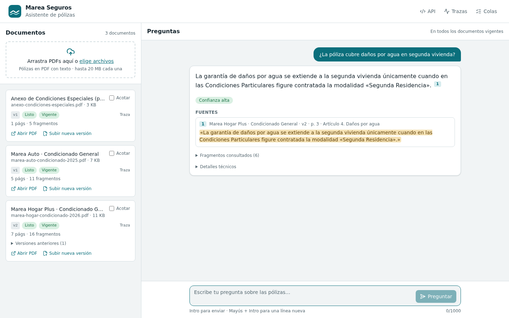
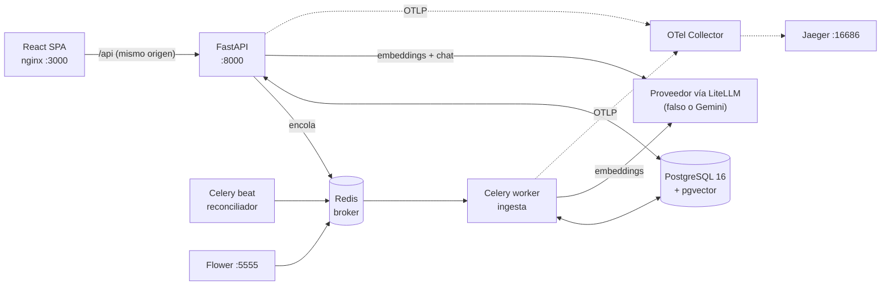

# Marea RAG · Asistente de pólizas

MVP de asistente interno para el equipo de atención al cliente de **Marea Seguros**, una aseguradora ficticia.

**Flujo:**
1. Un agente sube PDFs de pólizas y ve en vivo cómo se procesan.
2. Pregunta en lenguaje natural, por ejemplo «¿La póliza cubre daños por agua en segunda vivienda?».
3. Recibe una respuesta construida **solo con lo que dicen los documentos**. Cada afirmación lleva una cita literal verificada que se puede abrir en su contexto.
4. Si la evidencia no basta, el sistema lo dice en lugar de inventar.

Todo el recorrido (API, tarea de Celery, embeddings y LLM) queda en una sola traza de OpenTelemetry.



- **Decisiones razonadas y medidas:** [DECISIONS.md](DECISIONS.md).
- **Evaluación:** [eval/](eval/README.md).
- **Trazas:** [docs/observability.md](docs/observability.md).

## Arranque desde cero (un comando)

**Requisitos:** Docker con Compose v2. No hace falta ninguna clave: por defecto, el LLM y los embeddings son **proveedores falsos y deterministas**.

```bash
git clone https://github.com/Raul-Azahares/marea-rag.git && cd marea-rag
docker compose up --build --wait      # o: make up   (la primera build tarda unos minutos)
make demo                             # opcional: carga las pólizas de muestra
```

| Qué | Dónde |
|---|---|
| Interfaz (subida, estado, chat con citas) | http://localhost:3000 |
| API (Swagger) | http://localhost:8000/api/docs |
| Trazas (Jaeger) | http://localhost:16686 |
| Colas y workers (Flower) | http://localhost:5555 |

- **Puertos:** todos se publican solo en `127.0.0.1`. Postgres y Redis no se exponen.
- **Parar:** `make down`. Para borrar también los datos: `make clean`.
- **Comprobar que todo funciona de punta a punta:** `make smoke`. Sube un PDF, espera al worker, pregunta y verifica las dos trazas en Jaeger. Es el mismo script que ejecuta el CI.

### Con un proveedor real (opcional)

Copia `.env.example` a `.env` (no se versiona) y activa el bloque de Gemini a través de LiteLLM:

```
LLM_PROVIDER=litellm
LLM_MODEL=gemini/gemini-3.5-flash-lite
EMBEDDING_PROVIDER=litellm
EMBEDDING_MODEL=gemini/gemini-embedding-001
GEMINI_API_KEY=...
RETRIEVAL_MODE=vector
RETRIEVAL_MIN_SIMILARITY=0.64
CONFIDENCE_HIGH_SIMILARITY=0.72
```

Los tres últimos valores están calibrados con el conjunto de evaluación (ver [DECISIONS.md](DECISIONS.md#1-chunking-y-recuperación)). Cualquier otro proveedor de LiteLLM sirve cambiando el modelo.

> **Importante:** cambiar de modelo de embeddings obliga a reindexar. La búsqueda solo compara vectores del mismo modelo y lo filtra por columna, así que los documentos indexados con el modelo falso no se mezclan con los de Gemini.

## Qué hace

**Subida e ingesta asíncrona**
- `POST /api/v1/documents` valida el archivo, lo guarda, responde **202 al instante** con el id y encola la ingesta en Celery con Redis.
- La ingesta extrae el texto (pypdf), lo divide respetando la estructura (capítulos y artículos), genera los embeddings y lo guarda en PostgreSQL con pgvector.
- Es **idempotente y reintentable**. Expone sus estados (`pending`, `processing`, `ready`, `failed`) con la etapa y el porcentaje.

**Versionado**
- Subir el mismo contenido no duplica nada: se deduplica por SHA-256.
- Una nueva edición se sube como **versión** del documento y pasa a ser la vigente solo cuando termina bien. Las versiones antiguas se conservan para que las citas pasadas sigan siendo verificables.

**Consulta**
1. Recuperación con pgvector: vectorial o híbrida con la búsqueda de texto completo de Postgres, filtrando solo las versiones vigentes.
2. Una compuerta de evidencia (τ) responde «sin evidencia» **sin llamar al LLM** cuando no hay nada cercano.
3. El LLM, a través de LiteLLM, devuelve una salida estructurada en la que cada afirmación cita un fragmento con una frase literal.

**Validación posterior a la generación**
- **Reglas R1–R5:**
  - la cita apunta a un fragmento recuperado;
  - toda afirmación lleva cita;
  - la frase citada aparece literalmente en el fragmento;
  - el estado es coherente;
  - nunca se acepta como prueba un fragmento marcado como inyección.
- Si falla, hay un **reintento de reparación**. Si vuelve a fallar, se **degrada** (se quedan solo las afirmaciones verificadas) o se **rechaza**.
- La **confianza** la calcula el sistema, no el modelo.

**Interfaz React**
- Subida (arrastrar o elegir) y una lista con el estado de cada documento, que se actualiza sola por polling solo mientras hay ingestas en curso.
- Versiones, reintento y enlaces a cada traza.
- Chat con citas numeradas, con un aviso distinto por estado: parcial, contradictoria, sin evidencia o modelo caído.
- Visor del fragmento fuente con la cita resaltada y enlace al PDF en la página citada.

**Proveedores intercambiables por entorno:** `fake` (determinista y sin red, para tests y demo) o `litellm` (Gemini u otro).

**Observabilidad**
- Trazas OTel que cruzan api → Celery → worker → embeddings y LLM, con atributos GenAI (modelo y tokens) y de dominio.
- Logs JSON con `trace_id`.
- Collector y Jaeger dentro del compose.

## Arquitectura



| Servicio | Papel |
|---|---|
| `api` | FastAPI asíncrono: subida, estado, consulta y fragmentos. Sirve los PDFs para abrirlos en la página citada |
| `worker` | Celery: la ingesta. Monta los PDFs en solo lectura, con mínimo privilegio |
| `beat` | Lanza el reconciliador cada minuto: reencola lo que se quedó colgado |
| `migrate` | Aplica las migraciones de Alembic una vez y termina. Todo lo que usa la base de datos espera a que acabe |
| `frontend` | La SPA ya construida, servida por nginx sin root y con sistema de archivos de solo lectura. Redirige `/api` a la API |
| `postgres`, `redis` | pgvector sobre PG16. Redis con AOF, para que los mensajes encolados sobrevivan a un reinicio |
| `otel-collector`, `jaeger` | Reciben y muestran las trazas |
| `flower` | Monitor de Celery |

**Código:**
- `backend/app/`: `api/`, `ingestion/`, `rag/`, `providers/`, `worker/`, `db/`, `core/`.
- `frontend/src/`: componentes, cliente de la API y hooks de TanStack Query.

## Tests, calidad y CI

```bash
make test-infra       # Postgres (55432) y Redis (56379) desechables para los tests
make test             # backend: 217 tests (unitarios, integración con worker real, e2e)
make lint             # ruff + mypy --strict
make frontend-check   # eslint + tsc + vitest (50 tests) + build
make eval             # evaluación con proveedores falsos + quality gate
make smoke            # stack completo de punta a punta (con `make up` antes)
make audit            # vulnerabilidades conocidas en las dependencias (pip-audit + npm audit)
```

**Qué cubren los tests:**
- **Unitarios:** chunking, validación de citas (cada regla, la reparación, la degradación y el rechazo), detector de inyección, prompt, proveedores, confianza y validación de archivos.
- **Integración:** Postgres, Redis y un **worker de Celery real**: estados, idempotencia ante tareas duplicadas, PDF corrupto o vacío, reintentos, mensaje venenoso, reconciliador, versionado y búsqueda híbrida en SQL.
- **De extremo a extremo:** la consulta con el proveedor falso. Además, trazas en memoria y un test de higiene que demuestra que el texto de las pólizas nunca llega a spans ni a logs.

**CI** ([`.github/workflows/ci.yml`](.github/workflows/ci.yml)), en cada push:
- **Backend:** lint, tipos, migraciones, tests, el quality gate de la evaluación y la auditoría de vulnerabilidades.
- **Frontend:** lint, tipos, tests y build. Verifica también las firmas de npm y audita las dependencias de producción.
- **Smoke test:** `docker compose up --build --wait` del stack completo, subida, pregunta y trazas en Jaeger.

Las acciones están fijadas por SHA y el workflow solo tiene permisos de lectura.

## Evaluación

[`eval/dataset.yaml`](eval/dataset.yaml) tiene 38 preguntas sobre las pólizas de muestra, en cinco categorías: respondibles, de versión, multidocumento, de inyección y sin respuesta. Resultados ([detalle](eval/README.md)):

| | Proveedores falsos (CI) | Gemini, configuración recomendada |
|---|---|---|
| La fuente correcta llega al LLM (hit@6) / MRR | 0,87 / 0,76 | **1,00 / 0,98** |
| Respondibles respondidas / sin respuesta rechazadas | 0,81 / 0,71 | **1,00 / 1,00** |
| Hechos esperados presentes / citas en la fuente correcta | 0,52 / 0,68 | **0,92 / 0,98** |
| Hechos prohibidos, citas a versión vieja o a la inyección | 0 | **0** |
| Latencia p50 / p95 | — | 1,6 s / 3,8 s |

## Qué está hecho, qué no y limitaciones conocidas

**Hecho:** todos los requisitos del enunciado, más la evaluación con quality gate y el smoke test del stack en el CI.

**Fuera del MVP, de forma deliberada** (razonado en [DECISIONS.md](DECISIONS.md#4-alcance-del-mvp)):
- autenticación y multi-tenant;
- reranking (la evaluación muestra que no hace falta);
- streaming de respuestas (choca con validar antes de mostrar);
- OCR;
- memoria de conversación;
- borrado de documentos.

**Limitaciones conocidas:**
- **PDFs escaneados:** sin capa de texto fallan con un error explícito (`PDF_NO_TEXT`), sin OCR.
- **Fidelidad del texto de cada afirmación:** el validador comprueba que la cita existe literalmente, pero no que el texto de la afirmación la resuma con fidelidad. La interfaz muestra siempre la cita junto a la afirmación. La mejora natural sería un chequeo de implicación con NLI.
- **Inyección de prompt:** el detector es heurístico y una inyección parafraseada puede pasar sin marca. Las defensas estructurales no dependen de él (ver [seguridad](DECISIONS.md#6-seguridad)).
- **Versionado desde la interfaz:**
  - Si al subir no se indica título, se toma del nombre del primer archivo, y las versiones nuevas lo heredan. Una v2 subida como `…-2026.pdf` sigue llamándose «…-2025»; `make demo` usa títulos explícitos.
  - La deduplicación por contenido es global: subir como «nueva versión» un PDF que ya existe como documento propio devuelve ese documento, en lugar de enlazarlo.
- **Modelo falso:** su calidad es modesta por diseño. Es léxico y extractivo y sirve para probar el pipeline sin red. La calidad real se mide con Gemini.
- **Escala:** los PDFs se guardan en un volumen local y el corpus de evaluación es pequeño y sintético. Con miles de pólizas reales habría que recalibrar τ y volver a medir.
- **Cuotas:** la capa gratuita de Gemini limita mucho: 20 peticiones al día en `gemini-3-flash` y 1000 embeddings al día.

## Estructura del repositorio

```
backend/      FastAPI + Celery (app/), migraciones (alembic/), tests/, evaluation/ (arnés)
frontend/     React + TypeScript + Vite + Tailwind, nginx.conf, Dockerfile
infra/        configuración del OTel Collector
samples/      pólizas sintéticas (hogar 2025 y 2026, auto, anexo adversarial) y su generador
eval/         dataset de evaluación e informes
scripts/      smoke test y carga de la demo (solo biblioteca estándar)
docs/         observabilidad y capturas
```
