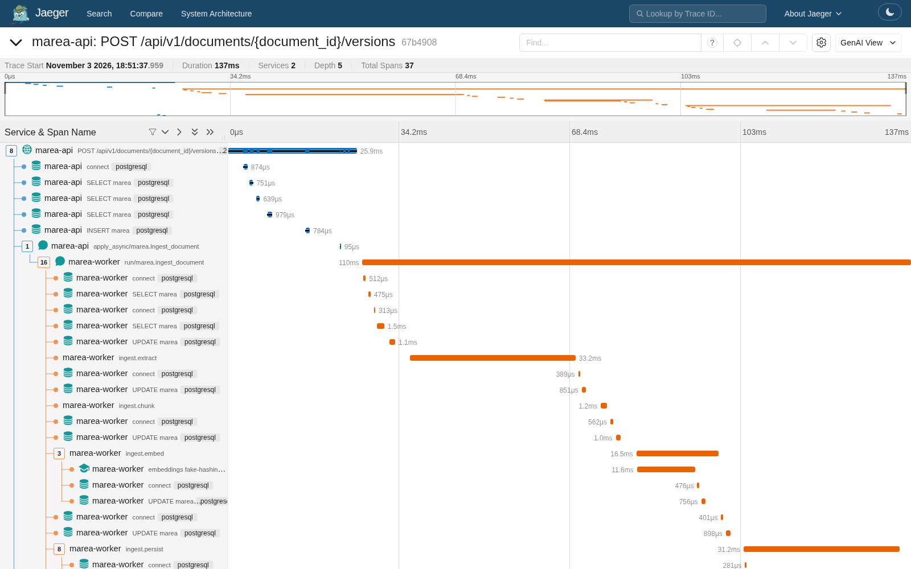
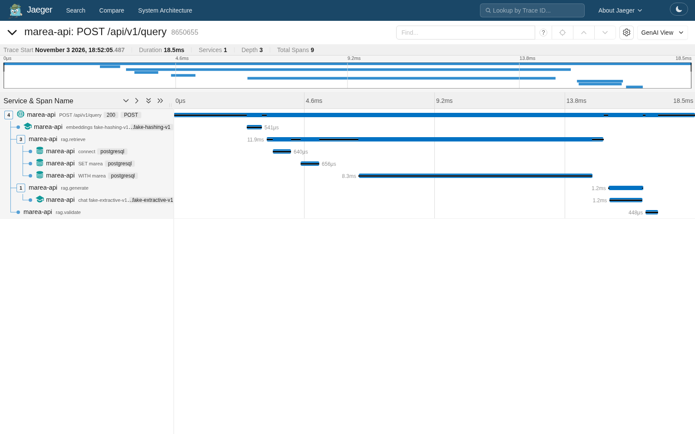
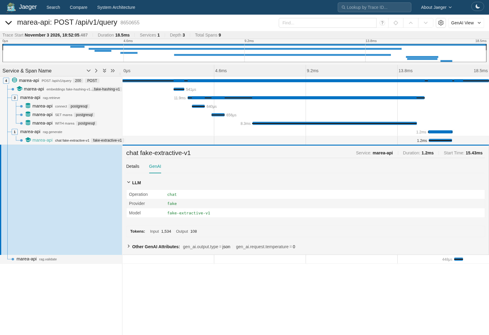

# Observabilidad: una traza completa

Cada operación deja **una sola traza de OpenTelemetry** que cruza los procesos: la API, el mensaje de Celery, el worker y las llamadas al proveedor de embeddings y al LLM.

- La API y el worker exportan por OTLP al **OTel Collector**, que las reenvía a **Jaeger**: http://localhost:16686, dentro del mismo `docker compose`.
- La interfaz enlaza cada ingesta y cada respuesta con su traza. Cada error de la API devuelve su `trace_id` para soporte.

Las capturas son de un stack recién levantado con `make demo`, con los proveedores falsos. Con Gemini la traza es idéntica; solo cambian los nombres de modelo (`chat gemini/gemini-3.5-flash-lite`, `embeddings gemini/gemini-embedding-001`) y las duraciones.

## 1. Subida e ingesta: API → Celery → worker → embeddings



Es la subida de la edición 2026 de la póliza de hogar como nueva versión: **37 spans de 2 servicios en un único árbol**.

| Span | Servicio | Qué es |
|---|---|---|
| `POST /api/v1/documents/{document_id}/versions` | marea-api | La petición HTTP: valida, guarda y responde 202 |
| `apply_async/marea.ingest_document` | marea-api | La publicación del mensaje en Redis. El contexto de la traza viaja en las cabeceras del mensaje |
| `run/marea.ingest_document` | marea-worker | La tarea de Celery: es **hija de la petición que la encoló**, aunque se ejecute en otro proceso y en otro momento |
| `ingest.extract`, `ingest.chunk` | marea-worker | Extracción con pypdf y chunking |
| `ingest.embed` → `embeddings fake-hashing-v1` | marea-worker | Un span GenAI por lote de embeddings |
| `ingest.persist` | marea-worker | Sustitución atómica de los fragmentos y cambio de versión vigente |
| `SELECT/INSERT/UPDATE marea`, `connect`, `LPUSH` | ambos | SQLAlchemy y Redis, instrumentados. Los spans de SQL guardan la consulta con marcadores (`%(t)s`), nunca los valores |

**Atributos de dominio** en los spans de ingesta:
- `marea.document.id`
- `marea.ingest.attempt`
- `marea.document.page_count`
- `marea.ingest.chunk_count`
- `marea.embedding.batch_count`
- `marea.embedding.input_tokens`

## 2. Pregunta: API → embeddings → recuperación → LLM → validación



| Span | Qué es |
|---|---|
| `POST /api/v1/query` | La petición |
| `embeddings fake-hashing-v1` | Embedding de la pregunta |
| `rag.retrieve` → `WITH marea` | La búsqueda en pgvector y texto completo, una sola consulta SQL. Atributos: `marea.rag.retrieval_mode`, `marea.rag.retrieved_count`, `marea.rag.best_similarity`, `marea.rag.min_similarity` |
| `rag.generate` → `chat fake-extractive-v1` | La llamada al LLM. Si la validación falla, aparece un segundo `rag.generate` con `marea.rag.attempt = 2`: la reparación |
| `rag.validate` | La validación de citas: `marea.rag.validation_passed`, `marea.rag.violation_count` y `marea.rag.violation_codes` |

En el span raíz quedan el estado final, la confianza, el número de citas y los intentos (`marea.rag.status`, `marea.rag.confidence`, `marea.rag.citation_count`, `marea.rag.attempts`).

## 3. Atributos GenAI de la llamada al LLM



Los spans `chat {modelo}` y `embeddings {modelo}` siguen las **convenciones semánticas GenAI de OpenTelemetry**:
- `gen_ai.operation.name`, `gen_ai.provider.name` y `gen_ai.request.model`;
- `gen_ai.usage.input_tokens` y `output_tokens`;
- `gen_ai.request.temperature`, `gen_ai.output.type` y, si falla, `error.type`.

Jaeger 2.22 las reconoce y las muestra en su pestaña *GenAI*, con el proveedor, el modelo y los tokens.

**Nunca se registran prompts, preguntas, respuestas ni texto de las pólizas.** Solo ids, recuentos, longitudes y puntuaciones. Un test de higiene mete texto centinela en una subida y en una pregunta, y comprueba que no aparece en ningún span ni log.

## 4. Logs correlacionados

La API y el worker escriben logs JSON con `trace_id` y `span_id`, incluidos el access log de uvicorn y los eventos de Celery. Desde una traza se encuentran todos sus logs, y al revés:

```console
$ docker compose logs api --no-log-prefix | grep 865065527929cd47b7d71e41409bc27b
{"status": "answered", "confidence": "high", "attempts": 1, "degraded": false, "citations": 1, "retrieved": 6, "best_similarity": 0.3618, "latency_ms": 15, "event": "query_answered", "level": "info", "logger": "app.rag.service", "timestamp": "2026-11-03T23:52:05.504819Z", "service": "marea-api", "trace_id": "865065527929cd47b7d71e41409bc27b", "span_id": "1ef2ccc6fae6e172"}
{"event": "172.28.0.10:43762 - \"POST /api/v1/query HTTP/1.1\" 200", "level": "info", "logger": "uvicorn.access", "timestamp": "2026-11-03T23:52:05.505537Z", "service": "marea-api", "trace_id": "865065527929cd47b7d71e41409bc27b", "span_id": "1ef2ccc6fae6e172"}
```

Para una ingesta, el mismo `trace_id` aparece en los logs de `api` y de `worker`: el `ingest_trace_id` de cada documento, visible en la API y enlazado desde la interfaz.

## 5. Cómo se comprueba automáticamente

- **Tests:** la suite completa corre instrumentada, exportando a memoria (`InMemorySpanExporter`).
  - Un test sube un PDF con un worker real y comprueba que la traza contiene la API, Celery, el worker y el span de embeddings con el mismo `trace_id` y los atributos esperados.
  - Otro comprueba los atributos GenAI de una consulta.
- **CI:** el job `smoke` levanta el stack completo con `docker compose`, sube un PDF, pregunta y consulta la API de Jaeger (`/api/v3/traces/{id}`). Exige que la traza de la subida contenga `marea-api` y `marea-worker` hasta los embeddings, y la de la pregunta, la llamada `chat`. Ver [`scripts/smoke_test.py`](../scripts/smoke_test.py).
